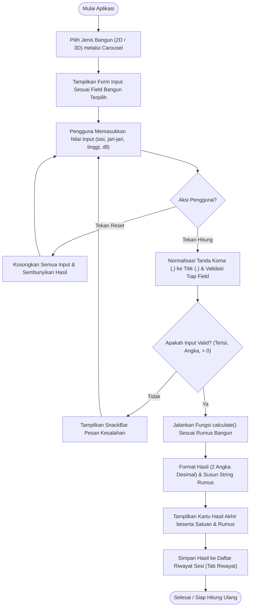

# Kalkulator Geometri (Geometry Calculator)

Aplikasi interaktif berbasis Flutter untuk menghitung **luas**, **keliling**, **luas permukaan**, dan **volume** dari berbagai bangun datar (2D) dan bangun ruang (3D), lengkap dengan tampilan rumus perhitungan, riwayat sesi, serta dukungan mode terang dan gelap.

---

## Daftar Isi

- [Fitur Utama](#fitur-utama)
- [Tech Stack](#tech-stack)
- [Alur Logika Aplikasi (Flowchart)](#alur-logika-aplikasi-flowchart)
- [Contoh Input dan Output](#contoh-input-dan-output)
- [Struktur Proyek](#struktur-proyek)
- [Panduan Instalasi & Penggunaan](#panduan-instalasi--penggunaan)
- [Panduan Berkontribusi](#panduan-berkontribusi)
- [Lisensi](#lisensi)

---

## Fitur Utama

### 1. Bangun Datar (2D)
Menghitung **Luas (`cm²`)** dan **Keliling (`cm`)** untuk 7 bangun datar:

| Bangun Datar | Input yang Diperlukan | Output |
| :--- | :--- | :--- |
| **Persegi** | Panjang sisi (`cm`) | Luas, Keliling |
| **Persegi Panjang** | Panjang (`cm`), Lebar (`cm`) | Luas, Keliling |
| **Segitiga** | Alas (`cm`), Tinggi (`cm`), Sisi lain B (`cm`), Sisi lain C (`cm`) | Luas, Keliling |
| **Jajar Genjang** | Alas (`cm`), Tinggi (`cm`), Sisi miring (`cm`) | Luas, Keliling |
| **Trapesium** | Sisi sejajar atas (`cm`), Sisi sejajar bawah (`cm`), Tinggi (`cm`), Sisi lain C (`cm`), Sisi lain D (`cm`) | Luas, Keliling |
| **Belah Ketupat** | Diagonal 1 (`cm`), Diagonal 2 (`cm`), Sisi (`cm`) | Luas, Keliling |
| **Lingkaran** | Jari-jari (`cm`) | Luas, Keliling |

### 2. Bangun Ruang (3D)
Menghitung **Volume (`cm³`)** dan **Luas Permukaan (`cm²`)** untuk 7 bangun ruang:

| Bangun Ruang | Input yang Diperlukan | Output |
| :--- | :--- | :--- |
| **Kubus** | Panjang sisi (`cm`) | Volume, Luas Permukaan |
| **Balok** | Panjang (`cm`), Lebar (`cm`), Tinggi (`cm`) | Volume, Luas Permukaan |
| **Tabung** | Jari-jari alas (`cm`), Tinggi (`cm`) | Volume, Luas Permukaan |
| **Kerucut** | Jari-jari (`cm`), Tinggi (`cm`), Garis pelukis (`cm`) | Volume, Luas Permukaan |
| **Limas (Alas Persegi)** | Sisi alas persegi (`cm`), Tinggi limas (`cm`), Tinggi sisi tegak (`cm`) | Volume, Luas Permukaan |
| **Prisma (Alas Segitiga)** | Alas segitiga (`cm`), Tinggi segitiga (`cm`), Sisi B (`cm`), Sisi C (`cm`), Tinggi prisma (`cm`) | Volume, Luas Permukaan |
| **Bola** | Jari-jari (`cm`) | Volume, Luas Permukaan |

### 3. Fitur Pendukung Lainnya
- **Pemilih Bangun Interaktif**: Carousel horizontal responsif (`PageView`) untuk memilih bangun 2D maupun 3D.
- **Tampilan Rumus Otomatis**: Menampilkan langkah rumus yang digunakan di bawah setiap hasil perhitungan.
- **Validasi Input**: Mendukung pemisah desimal titik (`.`) maupun koma (`,`), serta menolak input kosong, non-numerik, atau bernilai `<= 0`.
- **Riwayat Perhitungan**: Menyimpan hasil perhitungan selama sesi aplikasi berjalan beserta waktu perhitungan (`dd/mm/yyyy HH:mm`).
- **Mode Gelap (Dark Mode)**: Pengaturan tema terang/gelap pada halaman **Tentang**.

---

## Tech Stack

- **Framework**: Flutter (Material 3)
- **Bahasa Pemrograman**: Dart (`^3.12.2`)
- **Ikon & UI**: `cupertino_icons` (`^1.0.8`), Material Icons, `CustomPainter`
- **Linting & Testing**: `flutter_lints` (`^6.0.0`), `flutter_test`
- **Target Platform**: Android, iOS, Web, Windows, macOS, Linux

---

## Alur Logika Aplikasi (Flowchart)

Diagram berikut menggambarkan alur kerja utama aplikasi mulai dari pemilihan bangun hingga penyimpanan riwayat:



---

## Contoh Input dan Output

### Contoh 1 — Bangun Datar (Persegi Panjang)
- **Bangun Dipilih**: `Persegi Panjang` (`Bangun Datar`)
- **Input**:
  - `Panjang (cm)`: `10`
  - `Lebar (cm)`: `5`
- **Output di Layar**:
  - **Luas**: `50.00 cm²`
    - `Rumus: L = p × l = 10 × 5 = 50.00 cm²`
  - **Keliling**: `30.00 cm`
    - `Rumus: K = 2 × (p + l) = 2 × (10 + 5) = 30.00 cm`

### Contoh 2 — Bangun Ruang (Tabung)
- **Bangun Dipilih**: `Tabung` (`Bangun Ruang`)
- **Input**:
  - `Jari-jari alas (cm)`: `7`
  - `Tinggi (cm)`: `10`
- **Output di Layar**:
  - **Volume**: `1539.38 cm³`
    - `Rumus: V = π × r × r × t = 3,14 × 7 × 7 × 10 = 1539.38 cm³`
  - **Luas Permukaan**: `747.70 cm²`
    - `Rumus: LP = 2 × π × r × (r + t) = 2 × 3,14 × 7 × (7 + 10) = 747.70 cm²`

### Contoh 3 — Input Desimal & Validasi Error
- **Input Desimal Valid**: `7,5` atau `7.5` (koma otomatis dikonversi menjadi titik saat parsing).
- **Input Tidak Valid**:
  - Field kosong → `SnackBar`: `"<Nama Field> belum diisi."`
  - Nilai `0` atau negatif → `SnackBar`: `"<Nama Field> harus lebih besar dari 0."`

---

## Struktur Proyek

```text
kallkulator/
├── lib/
│   └── main.dart          # Entry point, konfigurasi bangun (shapes), kalkulasi, UI, riwayat, & tema
├── test/
│   └── widget_test.dart   # Pengujian widget Flutter
├── pubspec.yaml           # Metadata proyek, versi SDK Dart, dan dependensi
├── analysis_options.yaml  # Aturan linter (flutter_lints)
└── README.md              # Dokumentasi proyek
```

---

## Panduan Instalasi & Penggunaan

### Prasyarat
- [Flutter SDK](https://docs.flutter.dev/get-started/install) telah terpasang
- Dart SDK `^3.12.2`
- Emulator Android/iOS, browser (Chrome), atau desktop target sesuai platform yang ingin dijalankan

### Langkah Instalasi

1. **Clone repositori**
   ```bash
   git clone <url-repositori-anda>
   cd kallkulator
   ```

2. **Unduh dependensi**
   ```bash
   flutter pub get
   ```

3. **Jalankan aplikasi**
   ```bash
   flutter run
   ```
   Untuk menjalankan di platform spesifik (misal Web atau Windows):
   ```bash
   flutter run -d chrome
   flutter run -d windows
   ```

4. **Analisis kode**
   ```bash
   flutter analyze
   ```

### Cara Penggunaan Singkat
1. Buka tab **Kalkulator**, lalu geser atau ketuk kartu bangun pada bagian **Pilih bangun**.
2. Isi seluruh kolom parameter dimensi dalam satuan `cm`.
3. Tekan tombol **Hitung** untuk melihat hasil perhitungan dan rumusnya, atau **Reset** untuk mengosongkan input.
4. Buka tab **Riwayat** untuk melihat daftar perhitungan yang telah dilakukan selama sesi berjalan.
5. Buka tab **Tentang** untuk mengaktifkan atau menonaktifkan **Mode Gelap**.

---

## Panduan Berkontribusi

Kontribusi dari developer lain sangat terbuka. Ikuti langkah berikut untuk berkontribusi:

1. **Fork** repositori ini.
2. Buat *branch* baru untuk fitur atau perbaikan Anda:
   ```bash
   git checkout -b fitur/nama-fitur
   ```
3. Lakukan perubahan kode.
   - *Tips*: Untuk menambahkan bangun geometri baru, tambahkan entri `ShapeSpec` baru pada daftar `shapes` di `lib/main.dart`.
4. Pastikan kode lolos pemeriksaan linter:
   ```bash
   flutter analyze
   ```
5. *Commit* perubahan dengan pesan yang jelas:
   ```bash
   git commit -m "feat: tambah bangun ruang limas segi enam"
   ```
6. *Push* ke *branch* Anda lalu buat **Pull Request**.

---

## Lisensi

Proyek ini menggunakan lisensi **MIT** (sesuaikan atau tambahkan file `LICENSE` di root repositori apabila ingin mempublikasikan lisensi secara eksplisit).
